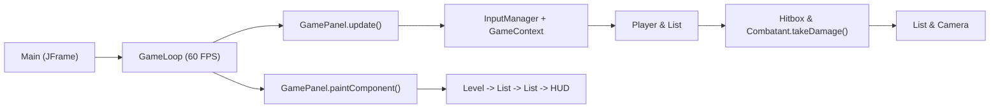

# Guia de Apresentação — Good of War (POO em Java)

> **Objetivo deste documento:** preparar você para apresentar o jogo **Good of War** ao professor, explicando como o jogo funciona por dentro e defendendo com segurança os **4 Pilares da Programação Orientada a Objetos (POO)**: **Abstração**, **Encapsulamento**, **Herança** e **Polimorfismo**.

---

## 1. Visão Geral do Jogo (Como apresentar na introdução)

O **Good of War** é um jogo de ação **2D hack-and-slash side-scroller** inspirado na franquia *God of War*, desenvolvido inteiramente em **Java puro** (Swing + AWT `Graphics2D` + Java Sound API), usando apenas a biblioteca **JLayer** (`lib/jlayer-1.0.1.jar`) para decodificar músicas e efeitos em `.mp3`, **sem engines externas** como Unity ou Godot.

### O que o jogador controla e vivencia
- **Protagonista:** Kratos, o Fantasma de Esparta, equipado com as *Lâminas do Caos* e o escudo espartano (*Aspis*).
- **Estrutura de campanha:** 3 arenas progressivas (`Templo de Esparta`, `Arena de Ares` e `Portões de Ares`) com plataformas de pedra, tochas animadas, baús de recompensa e batalha contra chefe final em 3 fases.
- **Inimigos:**
  - **Legionário Espartano (`SpartanLegionnaire`):** ágil, persegue Kratos e ataca com estocada de lança.
  - **Bruto Espartano (`SpartanBrute`):** guerreiro pesado com martelo de guerra, armadura que reduz **35% do dano** e *hyper-armor* contra recuos leves.
  - **General de Esparta / Arauto de Ares (`SpartanBoss`):** chefe da 3ª arena com **3 fases de combate** (70% e 35% de vida), ataque de espada imperial, ondas de choque no solo e resistência aumentada na Fase III.
- **Mecânicas principais:**
  - Combo de 3 golpes leves (`J` ou `Z`) e ataque giratório em área 360° *Cyclone of Chaos* (`K` ou `X`).
  - Esquiva com rolamento e frames de invulnerabilidade (`L` ou `C`).
  - Bloqueio com escudo que anula golpes comuns e gera Fúria (`U` ou `Shift`).
  - **Fúria Espartana (`I`):** dobra o dano, aumenta a velocidade e acelera os ataques.
  - **Baús (`E`):** concedem cura (`+45 VIDA`), carga máxima de Fúria ou melhoria de lâminas (`+2` de dano).
  - **Sistema de XP e Nível (`1`, `2`, `3`):** derrotar inimigos gera XP; ao subir de nível o jogador escolhe aumentar vida máxima, dano das lâminas ou duração da Fúria.
- **Gráficos e Áudio:**
  - **Gráficos 100% procedurais:** todos os personagens, cenário, barras de HUD e partículas são desenhados via código Java (`Graphics2D`), sem imagens/sprites externos.
  - **Áudio híbrido:** trilhas MP3 (`music/musicmenu.mp3`, `music/musicagameplay.mp3`) e som de espada (`music/espada.mp3`) via JLayer, além de efeitos sintetizados em tempo real via PCM (`javax.sound.sampled`) em `SoundManager`.

### Controles para demonstração ao vivo

| Tecla | Ação |
| :--- | :--- |
| `A` / `D` ou `←` / `→` | Movimentar Kratos |
| `W` / `↑` / `Espaço` | Pulo |
| `J` ou `Z` | Ataque leve (combo de 3 golpes) |
| `K` ou `X` | *Cyclone of Chaos* (ataque pesado em área 360°) |
| `L` ou `C` | Esquiva com invulnerabilidade |
| `U` ou `Shift` | Bloqueio com escudo |
| `I` | Ativar Fúria Espartana (barra cheia) |
| `E` | Abrir baú próximo |
| `1` / `2` / `3` | Escolher melhoria ao subir de nível |
| `P` ou `Esc` | Pausar / Retomar |
| `R` ou `Enter` | Iniciar / Avançar arena / Reiniciar |

---

## 2. Como o Jogo Funciona por Dentro (Arquitetura e Fluxo)

Se o professor perguntar *"Como o jogo roda do início ao fim?"*, explique este fluxo em 5 passos:

1. **Inicialização (`Main.java`):** cria a janela Swing (`JFrame`), adiciona o painel `GamePanel` (960x540) e inicia a thread do `GameLoop`.
2. **Loop Principal (`GameLoop.java`):** roda a **60 FPS** (`~16,66 ms` por quadro). A cada ciclo chama `gamePanel.update()` (lógica) e `gamePanel.repaint()` (desenho).
3. **Entrada e Estado (`InputManager.java` e `GameState.java`):** o teclado atualiza flags encapsuladas (`isLeft()`, `isJump()`, `isLightAttack()`, etc.). O `GamePanel` controla a máquina de estados: `MENU`, `PLAYING`, `PAUSED`, `LEVEL_UP`, `STAGE_CLEAR`, `GAME_OVER`, `VICTORY`.
4. **Atualização do Mundo (`GamePanel.update()`):**
   - Empacota os subsistemas (`Level`, `Camera`, `SoundManager`, `InputManager`, listas de `Hitbox` e `Particle`, e o `Player`) em um objeto `GameContext`.
   - Atualiza `player.update(context)` e percorre a lista `List<Enemy>` chamando `enemy.update(context)`.
   - Atualiza `Hitbox` ativas, resolve colisões de combate em `processCombatCollisions()` e atualiza todas as partículas em `List<Particle>`.
5. **Renderização (`GamePanel.paintComponent()`):**
   - Translada o `Graphics2D` de acordo com a `Camera` (que usa interpolação suave e tremor de tela).
   - Desenha o cenário (`Level`), todas as entidades (`List<Entity>`) e as partículas (`List<Particle>`).
   - Desfaz a translação para desenhar o `HUD` fixo e as telas do `MenuOverlay`.



---

## 3. Os 4 Pilares da POO no Código (Foco Principal da Apresentação)

### 3.1. Abstração

#### O que falar para o professor
> *"Abstração é modelar apenas o que é essencial de um conceito do domínio do jogo, definindo contratos claros do que as classes devem fazer sem expor ou fixar ainda os detalhes específicos de cada tipo."*

#### Onde está implementada no projeto
1. **Interface `Combatant` (`src/com/sparta/game/entities/Combatant.java`)**
   Define o contrato mínimo de qualquer ser que participa do combate:
   ```java
   public interface Combatant {
       void takeDamage(DamageInfo info);
       boolean isAlive();
       Rectangle getHitbox();
   }
   ```
   *Por que existe:* para o sistema de colisão, não importa se o alvo é Kratos, um Legionário, um Bruto ou o Boss — basta saber se está vivo, qual é sua hitbox e aplicar dano.

2. **Classe Abstrata `Entity` (`src/com/sparta/game/entities/Entity.java`)**
   ```java
   public abstract class Entity implements Combatant {
       public abstract void update(GameContext context);
       public abstract void render(Graphics2D g);
   }
   ```
   *Por que existe:* não faz sentido instanciar uma "entidade genérica" (`new Entity(...)`) dentro da arena. Todo ser vivo do jogo tem posição, velocidade, vida e física, mas **cada subclasse é obrigada** a definir sua própria lógica de atualização (`update`) e desenho (`render`).

3. **Classe Abstrata `Enemy` (`src/com/sparta/game/entities/Enemy.java`)**
   ```java
   public abstract class Enemy extends Entity {
       public abstract void updateAI(Player target, GameContext context);
   }
   ```
   *Por que existe:* todo inimigo compartilha cooldowns, alcance de detecção e gravidade, mas cada tipo tem seu próprio cérebro (`updateAI`).

4. **Classe Abstrata `Particle` (`src/com/sparta/game/effects/Particle.java`)**
   ```java
   public abstract class Particle {
       public abstract void render(Graphics2D g);
   }
   ```
   *Por que existe:* toda partícula tem posição, velocidade e tempo de vida (`life`/`maxLife`), mas cada efeito visual define como se desenha na tela.

---

### 3.2. Encapsulamento

#### O que falar para o professor
> *"Encapsulamento é proteger os dados internos de uma classe contra alterações diretas e inconsistentes, expondo apenas métodos controlados que garantem as regras de negócio."*

#### Onde está implementado no projeto
1. **Proteção e validação de vida em `Entity.java`:**
   Os atributos `health`, `maxHealth`, `x`, `y`, `vx`, `vy`, `alive` não são públicos. A alteração da vida passa por `setHealth(int)` e `setMaxHealth(int)`:
   ```java
   public void setHealth(int health) {
       this.health = Math.max(0, Math.min(health, this.maxHealth));
       if (this.health <= 0) {
           this.alive = false;
           onDeath();
       }
   }

   public void setMaxHealth(int maxHealth) {
       if (maxHealth <= 0) return;
       this.maxHealth = maxHealth;
       if (this.health > this.maxHealth) {
           this.health = this.maxHealth;
       }
   }
   ```
   *Regra garantida:* é impossível deixar a vida negativa, maior que a vida máxima, ou esquecer de marcar `alive = false` quando a vida chega a zero.

2. **Objeto de valor imutável em `DamageInfo.java`:**
   ```java
   public final class DamageInfo {
       private final int amount;
       private final AttackType attackType;
       private final double knockbackX;
       private final double knockbackY;
       private final boolean breakBlock;
       private final boolean isFromPlayer;
       // Apenas construtor (com Math.max(0, amount)) e getters; sem setters!
   }
   ```
   *Regra garantida:* depois que um golpe é criado, ninguém consegue adulterar o dano durante a detecção de colisão.

3. **Encapsulamento de entrada em `InputManager.java`:**
   Os arrays `keys[]`, `justPressed[]` e todas as flags (`left`, `right`, `jump`, etc.) são `private`. Outras classes (`GamePanel` e `Player`) apenas consultam pelos métodos getters (`isLeft()`, `isJump()`, `isLightAttack()`, etc.), impedindo que qualquer parte do jogo simule ou corrompa o estado do teclado diretamente.

4. **Proteção de coleções em `Level.java`:**
   `getPlatforms()` e `getChests()` retornam `Collections.unmodifiableList(...)`, impedindo que classes externas adicionem ou removam plataformas e baús da fase diretamente.

5. **Encapsulamento de progressão e recursos em `Player.java` e `ComboTracker.java`:**
   - `Player` controla `rage`, `experience`, `level`, `pendingLevelUps` e `bladeDamageBonus` como `private`, atualizados somente por métodos de regra como `addRage()`, `restoreHealth()`, `awardExperience()` e `applyLevelUpgrade()`.
   - `ComboTracker` mantém `comboCount`, `comboTimer` e `maxComboAchieved` privados e calcula internamente o rank de estilo (`BRUTAL!`, `SAVAGE!`, `RELENTLESS!`, `GODLIKE!`, `SPARTAN GOD!`).

---

### 3.3. Herança

#### O que falar para o professor
> *"Herança permite criar classes mais específicas a partir de uma classe base, reaproveitando atributos e métodos comuns e evitando repetição de código."*

#### Hierarquias completas do projeto

```text
Combatant (interface)
  └── Entity (abstract)
        ├── Player (Kratos)
        └── Enemy (abstract)
              ├── SpartanLegionnaire
              ├── SpartanBrute
              └── SpartanBoss

Particle (abstract)
  ├── FireParticle
  ├── BloodParticle
  ├── SparkParticle
  └── FloatingText
```

#### O que é reaproveitado na prática
1. **`Entity` → `Player` e `Enemy`:**
   - Toda a física de gravidade (`GRAVITY = 0.58`), velocidade máxima de queda (`MAX_FALL_SPEED = 12.0`), atrito horizontal (`vx *= 0.86`), limites laterais da arena e colisão com plataformas (`applyPhysics(Level)`) ficam escritos **uma única vez** em `Entity.java`.
   - `Player` e os 3 tipos de inimigos herdam posição, dimensões, vida, `getHitbox()`, `setHealth()` e `applyPhysics()` sem duplicar código.
2. **`Enemy` → `SpartanLegionnaire`, `SpartanBrute`, `SpartanBoss`:**
   - Todos herdam `updateEnemy(Player target, GameContext context)`, timers de ataque (`attackCooldown`, `attackTimer`), detecção (`detectionRange`, `attackRange`) e controle de atordoamento (`hitStunFrames`).
   - Cada subclasse foca apenas na sua personalidade: o Legionário usa lança rápida, o Bruto carrega martelo com faíscas e armadura pesada, e o Boss possui transição entre 3 fases e onda de choque.
3. **`Particle` → `FireParticle`, `BloodParticle`, `SparkParticle`, `FloatingText`:**
   - Todas herdam `x`, `y`, `vx`, `vy`, controle de vida útil `update()` e cálculo de transparência `getAlpha()`.
   - Cada subclasse apenas personaliza sua física e seu desenho (`FireParticle` sobe como chama; `BloodParticle` cai com gravidade; `FloatingText` desacelera enquanto exibe o texto de dano/XP).

---

### 3.4. Polimorfismo

#### O que falar para o professor
> *"Polimorfismo é tratar objetos de classes diferentes por meio de uma mesma referência (superclasse ou interface), fazendo com que cada objeto execute sua própria implementação em tempo de execução via sobrescrita (`@Override`)."*

#### Onde está implementado no projeto
1. **Atualização unificada de inimigos (`List<Enemy>` em `GamePanel.java`):**
   ```java
   for (Enemy enemy : enemies) {
       enemy.update(context);
   }
   ```
   A lista guarda instâncias de `SpartanLegionnaire`, `SpartanBrute` e `SpartanBoss` juntas como `Enemy`. Ao chamar `enemy.update(context)`, o `Enemy.update()` chama `updateEnemy()`, que dispara o método `@Override updateAI(...)` específico de cada subclasse em tempo de execução (*dynamic dispatch*).

2. **Renderização unificada de entidades (`List<Entity>` em `GamePanel.java`):**
   ```java
   List<Entity> renderEntities = new ArrayList<Entity>(enemies);
   renderEntities.add(player);
   for (Entity entity : renderEntities) {
       entity.render(g2);
   }
   ```
   O mesmo loop chama `entity.render(g2)`, e o Java decide dinamicamente se desenha Kratos, o Legionário, o Bruto ou o General de Esparta.

3. **Combate polimórfico pela interface `Combatant` (`GamePanel.tryApplyCombatHit`):**
   ```java
   private boolean tryApplyCombatHit(Hitbox hitbox, Combatant target) {
       if (!target.isAlive() || !hitbox.intersects(target.getHitbox())) {
           return false;
       }
       target.takeDamage(hitbox.getDamageInfo()); // Despacho Polimórfico!
       return true;
   }
   ```
   Tanto Kratos (`Player`) quanto qualquer inimigo (`Enemy`) implementam `Combatant`. O mesmo método aplica o golpe sem precisar saber qual classe concreta está recebendo.

4. **Comportamentos diferentes para a mesma mensagem (`@Override takeDamage`):**
   Quando `target.takeDamage(info)` é chamado, **4 comportamentos distintos** acontecem conforme o tipo real do objeto:
   - **`SpartanLegionnaire`:** usa a implementação padrão de `Entity` — sofre 100% do dano, recuo completo e 12 frames de stun.
   - **`SpartanBrute`:** sobrescreve `takeDamage` — sua armadura reduz o dano em **35%** (`info.getAmount() * 0.65`) e aplica *hyper-armor* (recuo reduzido).
   - **`SpartanBoss`:** sobrescreve `takeDamage` — mantém postura firme (`hitStunFrames = 3`, 20% do recuo) e na **Fase III** reduz **15%** do dano recebido.
   - **`Player`:** sobrescreve `takeDamage` — se estiver bloqueando (`blocking`) e o ataque não quebrar guarda, anula o dano e ganha `+15` de Fúria.

5. **Partículas polimórficas (`List<Particle>` em `GamePanel.java`):**
   Um único loop chama `p.update()` e `p.render(g2)` para `FireParticle`, `BloodParticle`, `SparkParticle` e `FloatingText`.

---

## 4. Simulado de Perguntas do Professor (Como responder na hora)

### Pergunta 1: *"Me mostre onde existe Abstração no seu código."*
**Resposta:**
> *"Temos quatro abstrações principais: a interface `Combatant`, que define o contrato de combate (`takeDamage`, `isAlive`, `getHitbox`); a classe abstrata `Entity`, que modela toda entidade viva e obriga `update()` e `render()`; a classe abstrata `Enemy`, que obriga cada inimigo a implementar `updateAI()`; e a classe abstrata `Particle`, que define a base de efeitos visuais e obriga `render()`."*

### Pergunta 2: *"Por que `Entity` é abstrata e não uma classe comum?"*
**Resposta:**
> *"Porque não existe uma 'entidade genérica' andando no jogo. Ou o objeto é o jogador (`Player`), ou é um tipo específico de inimigo. Tornar `Entity` abstrata impede que alguém dê `new Entity()` por acidente e força as subclasses a implementarem `update` e `render`."*

### Pergunta 3: *"Onde você garantiu Encapsulamento de verdade, além de só criar getters e setters?"*
**Resposta:**
> *"Em três lugares principais: primeiro, em `Entity.setHealth()` e `setMaxHealth()`, que validam limites para a vida nunca ficar negativa, passar do máximo ou ter vida máxima zero, além de disparar `onDeath()` automaticamente. Segundo, em `DamageInfo`, que é uma classe `final` com todos os atributos `private final` e sem setters, garantindo imutabilidade do golpe. Terceiro, em `InputManager` (onde o estado do teclado só pode ser lido por getters) e em `Level` (que retorna `Collections.unmodifiableList` para ninguém alterar plataformas ou baús de fora)."*

### Pergunta 4: *"Como a Herança evitou código repetido?"*
**Resposta:**
> *"Toda a física de gravidade, atrito, limites da fase e colisão com plataformas está no método `applyPhysics()` da classe `Entity`. Nem `Player`, nem `SpartanLegionnaire`, nem `SpartanBrute`, nem `SpartanBoss` precisaram reescrever física ou controle de vida — todos herdam isso de `Entity` (e os inimigos ainda herdam a estrutura de IA e timers de `Enemy`). O mesmo vale para as 4 partículas que herdam ciclo de vida e transparência de `Particle`."*

### Pergunta 5: *"Me prove que existe Polimorfismo rodando no seu jogo."*
**Resposta:**
> *"No `GamePanel`, temos três provas diretas: a lista `List<Enemy>` chama `enemy.update(context)` e cada inimigo executa sua própria IA; a lista `List<Entity>` chama `entity.render(g2)` para desenhar Kratos e todos os inimigos; e o método `tryApplyCombatHit(Hitbox, Combatant)` chama `target.takeDamage()`. Quando o golpe acerta o `SpartanBrute`, ele reduz 35% do dano; no `SpartanLegionnaire`, entra o dano cheio; no `SpartanBoss`, ele resiste ao stun; e no `Player`, se o escudo estiver erguido, o dano é bloqueado. Tudo com a mesma chamada `takeDamage()`."*

### Pergunta 6: *"Qual a diferença entre `Entity` (classe abstrata) e `Combatant` (interface) no seu projeto?"*
**Resposta:**
> *"`Combatant` define apenas **o que** um combatente faz no combate (levar dano, estar vivo, ter hitbox), sem guardar atributos nem física. Já `Entity` guarda estado compartilhado (`x`, `y`, `vx`, `vy`, `health`) e código pronto como `applyPhysics()`, implementando `Combatant` para toda a hierarquia de personagens."*

---

## 5. Roteiro Rápido de Apresentação (5 a 7 minutos)

1. **1 min — Demonstração rodando:** execute `run.bat`, mostre o menu inicial, ande, pule, faça o combo de 3 golpes (`J`), use o ciclone (`K`), bloqueie (`U`) e abra um baú (`E`).
2. **1 min — Arquitetura:** mostre rapidamente no editor `Main.java` → `GameLoop.java` → `GamePanel.java` para explicar os 60 FPS e a separação em pacotes (`core`, `entities`, `combat`, `effects`, `world`, `ui`).
3. **3 min — Os 4 Pilares no código (abra nesta ordem):**
   - `Combatant.java` + `Entity.java` + `Enemy.java` → explique **Abstração** e **Herança**.
   - `Entity.java` (`setHealth`) + `DamageInfo.java` + `InputManager.java` → explique **Encapsulamento**.
   - `GamePanel.java` (`update`, `tryApplyCombatHit`, `paintComponent`) + `SpartanBrute.java` (`takeDamage`) → explique **Polimorfismo**.
4. **1 min — Encerramento:** responda às perguntas usando a tabela da Seção 4 e o arquivo-guia `OOPDocumentation.java`.
