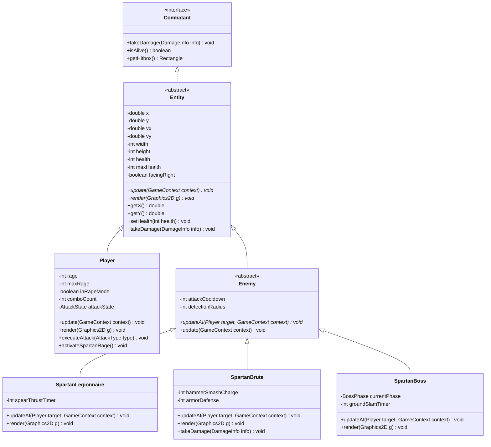

# 🏛️ Os 4 Pilares da Programação Orientada a Objetos (POO)
## Aplicação Prática no Jogo: *Good of War*

Este documento serve como memorial descritivo e defesa técnica dos quatro pilares fundamentais da **Programação Orientada a Objetos (POO)** aplicados no código-fonte do jogo para a avaliação do **SENAI**.

---

## 1. Diagrama de Classes e Hierarquia (UML)



---

## 2. Detalhamento dos 4 Pilares no Código

### 🏛️ 1. Abstração (Abstraction)

**Conceito:**
A abstração consiste em isolar as características essenciais de um objeto do mundo real (ou do domínio do jogo), ocultando detalhes operacionais complexos e expondo apenas interfaces e contratos claros.

**Onde está no projeto:**
1. **Classe Abstrata `Entity.java`:**
   Nenhum objeto puro do tipo "Entidade genérica" existe solto no jogo — você só encontra jogadores, legionários ou brutos. A classe `Entity` define a essência compartilhada (posição, dimensões, vida, colisão) e declara os métodos abstratos que obrigam as subclasses a definir como se comportam e como se desenham:
   ```java
   public abstract void update(GameContext context);
   public abstract void render(Graphics2D g);
   ```
2. **Interface `Combatant.java`:**
   Define a abstração pura de qualquer ser capaz de sofrer dano e lutar na arena, independente de ser Kratos, um legionário ou o chefe final:
   ```java
   public interface Combatant {
       void takeDamage(DamageInfo info);
       boolean isAlive();
       Rectangle getHitbox();
   }
   ```
3. **Classe Abstrata `Enemy.java`:**
   Abstrai o cérebro das criaturas hostis através do método abstrato:
   ```java
   public abstract void updateAI(Player target, GameContext context);
   ```

---

### 🛡️ 2. Encapsulamento (Encapsulation)

**Conceito:**
Consiste em proteger o estado interno de um objeto contra modificações diretas ou indevidas por agentes externos. O acesso é feito estritamente por meio de métodos públicos com validação de regras de negócio.

**Onde está no projeto:**
1. **Blindagem de Atributos:**
   Em `Entity.java` e `Player.java`, os atributos como `health`, `maxHealth`, `x`, `y`, `rage`, `invulnerable` são estritamente `private` ou `protected`.
2. **Regras de Negócio em Setters:**
   Não é possível definir vida negativa ou acima do máximo; o método `setHealth(int value)` encapsula a trava de segurança:
   ```java
   public void setHealth(int health) {
       this.health = Math.max(0, Math.min(health, this.maxHealth));
       if (this.health <= 0) {
           this.alive = false;
           this.onDeath();
       }
   }
   ```
3. **Imutabilidade em Value Objects:**
   A classe `DamageInfo.java` (que transporta dano, tipo de ataque, empurrão/knockback e se quebra defesa) possui atributos `final` e apenas getters, impedindo mutação em tempo de colisão.

---

### 🧬 3. Herança (Inheritance)

**Conceito:**
Mecanismo que permite a uma classe derivada (subclasse) herdar atributos e métodos de uma classe base (superclasse), promovendo o reaproveitamento de código e a estruturação hierárquica do domínio.

**Onde está no projeto:**
1. **Hierarquia de Entidades:**
   ```
   Entity (superclasse)
     ├── Player (subclasse Kratos)
     └── Enemy (subclasse abstrata de inimigos)
           ├── SpartanLegionnaire (soldado ágil com lança)
           ├── SpartanBrute (guerreiro pesado de elite)
           └── SpartanBoss (General de Esparta / Arauto)
   ```
   - `Player` e `Enemy` herdam toda a física (`applyGravity()`, detecção de chão, atrito, cálculo de limites da tela) de `Entity`, sem precisar reescrever uma única linha de colisão física básica.
2. **Hierarquia de Efeitos (`Particle.java`):**
   - `Particle` define vida útil, cor, velocidade e fade out.
   - `FireParticle` (efeito das Lâminas do Caos), `BloodParticle` (impactos corporais) e `SparkParticle` (bloqueios de escudo) herdam e personalizam sua física.

---

### ⚡ 4. Polimorfismo (Polymorphism)

**Conceito:**
Capacidade de objetos de diferentes classes derivadas responderem à mesma mensagem (chamada de método) de maneiras distintas através de sobrescrita (`@Override`) e vinculação dinâmica (dynamic dispatch).

**Onde está no projeto:**
1. **Coleções Genéricas e Loop Polimórfico no `GamePanel`:**
   O motor de jogo não precisa saber se o inimigo é um soldado, um bruto ou o chefão. Ele apenas armazena uma lista polimórfica `List<Enemy> enemies` e itera sobre ela:
   ```java
   for (Enemy enemy : enemies) {
       enemy.update(context); // Chama a IA polimórfica correspondente!
   }

   for (Enemy enemy : enemies) {
       enemy.render(g2d);     // Desenha o sprite polimórfico correto!
   }
   ```
2. **Polimorfismo de Ataque e Dano (`takeDamage`):**
   - Quando um `SpartanLegionnaire` recebe dano, ele sofre recuo (knockback) total e entra em stun.
   - Quando o `SpartanBrute` recebe o mesmo golpe, ele **sobrescreve** `takeDamage` usando sua armadura espartana de bronze para reduzir o dano recebido em 35% e ignorar pequenos empurrões (`hyper-armor`).
3. **Polimorfismo de Renderização (`render`):**
   - Kratos se renderiza com as Lâminas do Caos flamejantes, tatuagem vermelha e pele cinza de cinzas.
   - O Legionário se renderiza com elmo com pluma, túnica vermelha e lança espartana.
   - O Boss se renderiza com estatura gigante, armadura de ouro e espada larga de duas mãos.

---

## 3. Resumo para Apresentação Acadêmica

| Pilar | Pergunta que responde na banca | Onde mostrar no código |
| :--- | :--- | :--- |
| **Abstração** | *"Qual o modelo conceitual comum a todos os seres do jogo?"* | [`Entity.java`](file:///c:/Users/User/OneDrive/Área de Trabalho/Jogo Senai/src/com/sparta/game/entities/Entity.java) e [`Combatant.java`](file:///c:/Users/User/OneDrive/Área de Trabalho/Jogo Senai/src/com/sparta/game/entities/Combatant.java) |
| **Encapsulamento**| *"Como garantimos que a vida, fúria e coordenadas não fiquem inconsistentes?"* | Getters/Setters com validação em `Entity.java` e `Player.java` |
| **Herança** | *"Como evitamos duplicar lógica de física e colisão para cada criatura?"* | `Player extends Entity` e `Enemy extends Entity` |
| **Polimorfismo** | *"Como o Game Loop gerencia dezenas de inimigos distintos com um único loop?"* | `@Override` de `updateAI()` e `render()` chamado via `List<Enemy>` |

